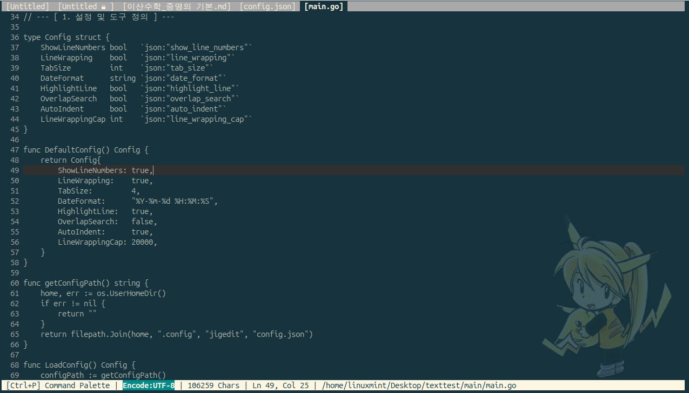

[README.md](https://github.com/user-attachments/files/35291691/README.md)

# JigEdit

"A Sane Editor For The Sane People"

As the discription implies, **jigedit** aims to be a simple and modern terminal-based text editor  that can be picked up effortlessly thanks to its almost non-existent learning curve.


heres a picture of jigedit editing it's own code




## Features

- NotePad-like shortcuts 
- extremely lightweight, zero external dependencies
- enter current time by pressing F5 (just like NotePad!)
- out-of-the-box experience : no need to spend eternity editing configs or learning new shortcuts
- multi-tab management
- command palette
- **built-in TUI file picker:** mouse & keyboard controllable, shows all dotfiles by default, zero GUI dependencies — no more spending most of your time writing file PATHs
- built-in clipboard & bracketed paste support (OSC 52, internal clipboard, and automatic integration with `wl-clipboard` / `xclip` if present)
- intuitive terminal commands


## Installation

### Install jigedit on linux **(recommended)** :

```bash
curl -sL https://raw.githubusercontent.com/fr0mhe11/jigedit/main/install.sh | bash
```

### install via ```go install``` :

```bash
go install github.com/fr0mhe11/jigedit@latest
```


### to uninstall (curl)

```bash
# 1. remove program file
sudo rm /usr/local/bin/jigedit

# 2. remove settings file (optional)
rm -rf ~/.config/jigedit
```


## TODO
- [x] extensive encoding support
- [x] multi cursor feature

- [ ] make selection behave like micro/kwrite?
- [ ] syntex highlighting
- [ ] atomic file save

(still deciding whether to implement the last 2 features)
